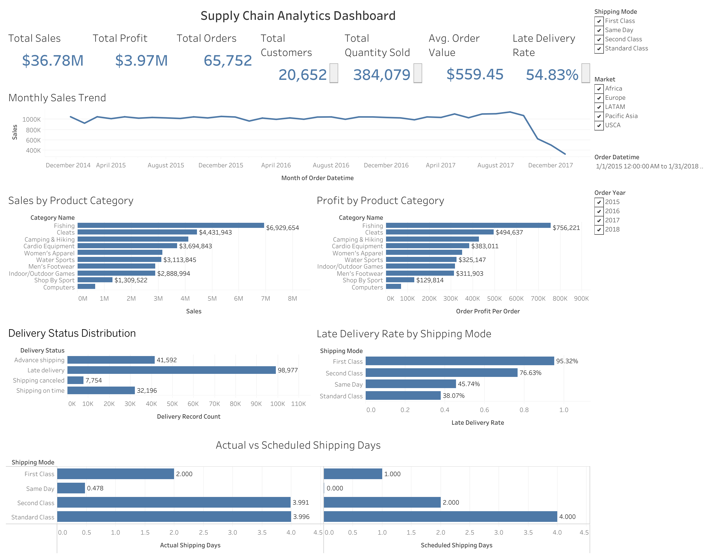

# Retail Supply Chain Analytics | SQL & Tableau

## Project Overview

An end-to-end supply chain analytics project using MySQL, SQL, and Tableau to analyze retail sales, profitability, order performance, and shipping efficiency.

The project analyzes **180,519 supply chain records** from the DataCo Smart Supply Chain dataset. It transforms raw transactional data into actionable business insights through SQL analysis and an interactive Tableau dashboard.

## Tech Stack

- **Database:** MySQL
- **Data Analysis:** SQL
- **Data Visualization:** Tableau Public
- **Development Tools:** VS Code, Git, GitHub

## Key Performance Indicators

| KPI | Value |
|---|---:|
| Total Sales | $36.78M |
| Total Profit | $3.97M |
| Total Orders | 65,752 |
| Total Customers | 20,652 |
| Total Quantity Sold | 384,079 |
| Average Order Value | $559.45 |
| Late Delivery Rate | 54.83% |

## Dashboard Features

The interactive Tableau dashboard includes:

- Seven KPI cards for tracking business performance.
- Monthly sales trends and product category analysis.
- Sales and profitability comparisons across product categories.
- Delivery status distribution and shipping performance analysis.
- Interactive filters for Market, Shipping Mode, and Order Date.
- Custom tooltips displaying sales, profit, profit margin, and delivery metrics.

## Key Business Insights

**1. Shipping delays:** Approximately 54.83% of delivery records were flagged as late, highlighting opportunities to improve shipping reliability.

**2. Shipping mode performance:** First Class shipping had the highest late delivery rate at approximately 95.32%, indicating potential challenges in meeting expedited delivery expectations.

**3. Product performance:** Fishing was the highest-performing product category by sales, generating approximately $6.93M.

**4. Profitability:** Total recorded profit reached approximately $3.97M, enabling comparison of profitability across product categories and markets.

## Project Workflow

1. Imported the raw supply chain dataset into MySQL.
2. Cleaned and transformed transactional data using SQL.
3. Validated records and calculated business KPIs.
4. Analyzed product sales, profitability, and shipping performance.
5. Exported the cleaned analytical dataset for Tableau.
6. Developed an interactive dashboard with dynamic filters and custom tooltips.

## Repository Structure

```text
Retail-Supply-Chain-Analytics/
├── sql/
│   ├── 01_create_database.sql
│   ├── 02_create_tables.sql
│   ├── 02_setup_raw_data.sql
│   ├── 03_data_cleaning.sql
│   ├── 04_kpi_analysis.sql
│   ├── 05_supply_chain_analysis.sql
│   ├── 06_business_insights.sql
│   └── 07_tableau_export.sql
├── screenshots/
├── tableau/
├── .gitignore
└── README.md
```

## Data Source and Privacy

The project uses the DataCo Smart Supply Chain dataset.

Raw and processed datasets are excluded from this repository because they contain customer-related information. SQL scripts and project documentation are provided to demonstrate the analytical workflow.

## Tableau Dashboard

**Interactive Dashboard:** [View on Tableau Public](ADD_YOUR_TABLEAU_PUBLIC_URL_HERE)

## Dashboard Preview




## Skills Demonstrated

SQL Data Cleaning | Data Transformation | MySQL | Exploratory Data Analysis | KPI Development | Tableau | Dashboard Development | Data Visualization | Supply Chain Analytics | Business Intelligence | Data Validation | Business Insights